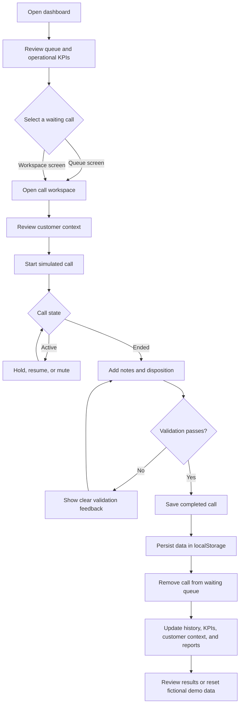
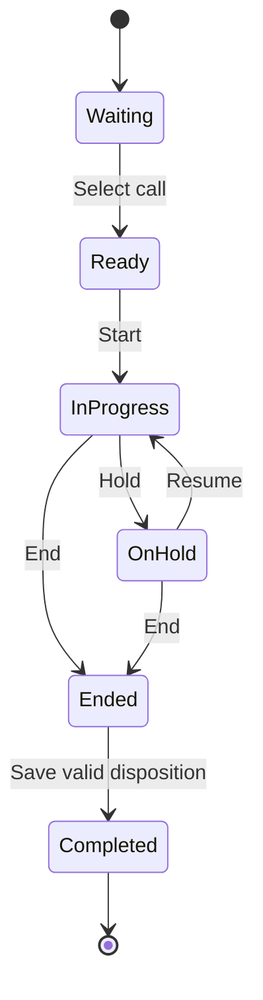

# On-Ground.ai Call Centre

> A polished, responsive, frontend-only call-centre workspace for managing fictional inbound calls from queue triage through disposition, history, and reporting.


## Table of contents

- [Overview](#overview)
- [Key capabilities](#key-capabilities)
- [Application flow](#application-flow)
- [Technology](#technology)
- [Architecture and project structure](#architecture-and-project-structure)
- [Getting started](#getting-started)
- [Using the demo](#using-the-demo)
- [Data, persistence, and reporting](#data-persistence-and-reporting)
- [Quality checks](#quality-checks)
- [Responsive design and accessibility](#responsive-design-and-accessibility)
- [Limitations](#limitations)
- [Troubleshooting](#troubleshooting)
- [AI disclosure](#ai-disclosure)

## Overview

On-Ground.ai Call Centre is a realistic staff-facing dashboard for a simulated customer-support operation. It gives an agent one place to:

1. Review and filter an inbound waiting queue.
2. Select a customer and inspect their account context.
3. Run a simulated call with start, hold, resume, mute, and end controls.
4. Capture notes and save a validated call disposition.
5. Move the completed call into history and update dashboard metrics and reports.

The project intentionally uses **fictional records** and browser-local storage. It is suitable for demonstrating frontend architecture, state handling, responsive UI design, validation, and data consistency without requiring a backend.

## Key capabilities

| Area | Included behavior |
|---|---|
| Dashboard | Derived KPIs for completed calls, waiting calls, average handling time, resolution rate, queue urgency, and recent activity. |
| Waiting queue | Search, priority filters, stable queue positions, and timestamp-based elapsed wait times. |
| Call workspace | Customer context, call timer, simulated start/hold/resume/mute/end state transitions, notes, and dispositions. |
| Disposition | Required category, outcome, and resolution fields; escalation reason required for escalated calls; optional follow-up flag. |
| Customers | Searchable directory with account tier, contact details, issue status, orders, and interaction context. |
| Call history | Search, resolution filters, Today, Yesterday, and custom date-range filters. |
| Reports | Resolution, escalation, follow-up, category, and completed-call summaries derived from completed records. |
| Preferences | Agent display name, compact density, notification, dark-appearance preferences, and demo-data reset. |
| Persistence | Calls, notes, dispositions, customers, and preferences persist in the current browser through `localStorage`. |

## Application flow



### Call lifecycle rules



- A call cannot be completed until it has ended.
- A disposition requires category, outcome, and resolution.
- An escalated disposition also requires an escalation reason.
- Completed calls are protected against duplicate completion and do not return to the waiting queue.
- The call timer advances only while the simulated call is active, not while held.

## Technology

| Technology | Purpose |
|---|---|
| [React 19](https://react.dev/) | Component-based application UI. |
| [TypeScript](https://www.typescriptlang.org/) | Type-safe application state and UI code. |
| [Vite](https://vite.dev/) | Local development server and production bundling. |
| [Wouter](https://github.com/molefrog/wouter) | Lightweight client-side routing. |
| [Tailwind CSS](https://tailwindcss.com/) | Shared utility and theme integration. |
| [Lucide React](https://lucide.dev/) | Consistent interface icons. |
| [pnpm](https://pnpm.io/) | Workspace package management. |

## Architecture and project structure

```text
.
├── artifacts/
│   └── on-ground-call-centre/        # Main frontend application
│       ├── public/                   # Static browser assets
│       ├── src/
│       │   ├── App.tsx               # Domain model, state, routes, and screens
│       │   ├── index.css             # Theme, responsive layout, and components
│       │   └── main.tsx              # React entry point
│       ├── index.html
│       ├── package.json              # App-level scripts and dependencies
│       ├── tsconfig.json
│       └── vite.config.ts            # Vite server/build configuration
├── lib/                              # Shared workspace packages
├── scripts/                          # Workspace scripts
├── package.json                      # Workspace commands
├── pnpm-workspace.yaml               # pnpm workspace/catalog configuration
├── tsconfig.base.json                # Shared TypeScript settings
└── README.md                         # This document
```

### Frontend data model

The frontend keeps a small, maintainable domain model in [`App.tsx`](./artifacts/on-ground-call-centre/src/App.tsx):

```text
AppData
├── customers[]     Customer account and profile context
├── calls[]         Waiting and completed call records
├── notes{}         Notes keyed by stable call ID
└── preferences     Agent name and local UI preferences
```

All records have stable identifiers. The queue is derived from calls whose status is `Waiting`; history and reports are derived only from calls whose status is `Completed`.

### Data consistency

- Wait time is calculated from `queuedAt`, not a table-row index.
- Completing a call updates the same shared record used by dashboard, customer, history, and report views.
- Report totals exclude waiting calls.
- Empty reports and empty search results use dedicated empty states.
- Saved data is validated during application startup; malformed browser storage falls back safely to the fictional seed data.

## Getting started

### Prerequisites

Install the following before running the project:

- [Node.js](https://nodejs.org/) 20 or later
- [pnpm](https://pnpm.io/installation) 9 or later

### Install dependencies

From the repository root:

```bash
pnpm install
```

### Run the development server

The Vite configuration defaults to port `5173` and base path `/`. Set `PORT` or `BASE_PATH` only when your environment needs different values.

**macOS / Linux**

```bash
pnpm --filter @workspace/on-ground-call-centre run dev
```

**Windows PowerShell**

```powershell
pnpm --filter @workspace/on-ground-call-centre run dev
```

Open the localhost URL printed by Vite, normally `http://localhost:5173`.

### Build and preview production output

```bash
pnpm --filter @workspace/on-ground-call-centre run build
pnpm --filter @workspace/on-ground-call-centre run serve
```

The production bundle is written to `artifacts/on-ground-call-centre/dist/public`.

## Using the demo

### Complete a simulated call

1. Go to **Waiting queue** or **Call workspace**.
2. Select a fictional queued call.
3. Review customer details, current open issues, and the call reason.
4. Select **Start simulated call**.
5. Use **Hold**, **Resume**, and **Mute** as desired.
6. Select **End call**.
7. Write notes and select a category, outcome, and resolution status.
8. If the resolution is **Escalated**, add a reason.
9. Select **Save disposition**.
10. Find the call in **Call history** and verify its effect in **Reports**.

### Customize the workspace

Open **Settings** to:

- Set and save the agent display name.
- Toggle compact density.
- Toggle in-app notifications.
- Toggle dark appearance.
- Reset all browser-local changes to the original fictional demo data.

## Data, persistence, and reporting

### Browser storage

The application stores local state under:

```text
onground-call-centre-demo-v1
```

This includes calls, notes, customer-related state, dispositions, and preferences. Data is local to the current browser profile and device; it is not shared with other users.

### Fictional demo timeline

Seeded data uses a rolling timeline so that current-day and yesterday filters remain demonstrable. All names, contact details, account data, calls, and outcomes are fictional.

### Reporting behavior

Report cards and charts are calculated from completed calls:

- **Completed calls**: Number of records with `Completed` status.
- **Resolved**: Completed records marked `Resolved`.
- **Escalated**: Completed records marked `Escalated`.
- **Follow-up needed**: Completed records with follow-up enabled.
- **Calls by category**: Grouped completed-call categories.

These metrics are demonstration values, not production service-level metrics.

## Quality checks

Run the targeted application checks from the repository root:

```bash
pnpm --filter @workspace/on-ground-call-centre run typecheck
pnpm --filter @workspace/on-ground-call-centre run build
```

The latest verification covered:

- TypeScript compilation.
- Production Vite build.
- Development-server HTTP response.
- Queue wait-time rendering.
- Agent name editing and fallback save behavior.
- History Today, Yesterday, and custom date-range filters.
- Desktop and mobile responsive smoke checks, including no horizontal overflow at a narrow mobile width.

## Responsive design and accessibility

- Desktop uses a persistent operational sidebar.
- Smaller screens use a compact fixed bottom navigation.
- Tables preserve their structure in horizontally scrollable wrappers when necessary.
- Controls have accessible labels.
- Inputs provide visible focus states.
- Status states use distinct visual treatments for waiting, resolved, escalated, and informational states.
- Layout uses semantic headings, buttons, navigation, forms, tables, and status feedback.

## Limitations

This project is intentionally scoped as a frontend assignment demonstration:

- No backend or shared server-side database.
- No user authentication or authorization.
- No real PSTN, VoIP, audio, or telephony integration.
- No live CRM, customer, payment, or order-system integration.
- No real customer data or phone numbers.
- Browser storage can be cleared by the user or browser.
- Reports are examples based only on fictional locally saved records.

## Troubleshooting

### pnpm is not recognized

Install or activate pnpm, then retry:

```bash
corepack enable
corepack prepare pnpm@latest --activate
```

### Demo data looks unexpected

Open **Settings** and select **Reset demo data**. This clears the application’s saved local demo state and restores the fictional seed records.

## AI disclosure

AI assistance was used to help develop, test, and document this project. The implementation and fictional sample records are provided solely as a frontend demonstration.
